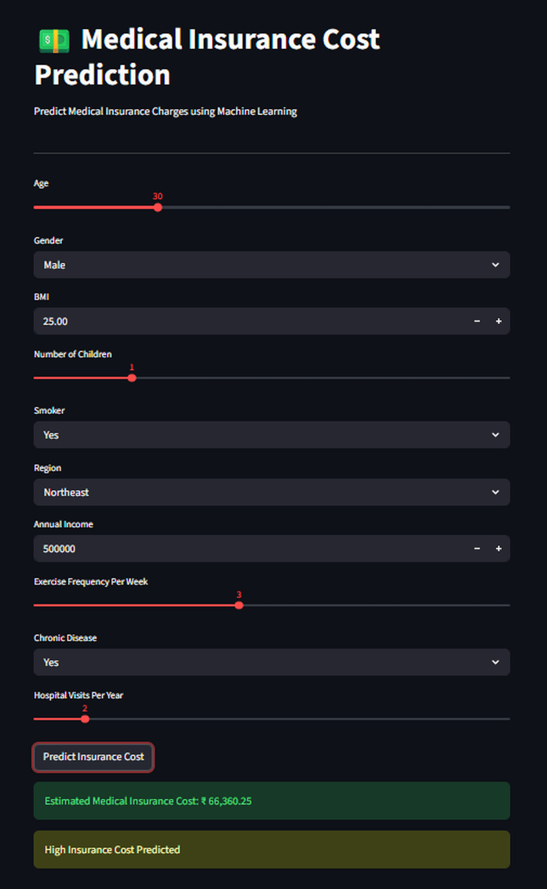

# 💵 Medical Insurance Cost Prediction

Predict a person's annual medical insurance cost from health, lifestyle and demographic data, with a Streamlit app for instant predictions.




---

## 🚀 Quick Start

```bash
git clone https://github.com/Imran-k10/medical-insurance-cost-prediction-ml.git
cd medical-insurance-cost-prediction-ml
pip install -r requirements.txt
streamlit run app.py
```

## 🎯 What It Does

Enter 10 details (age, gender, BMI, children, smoker status, region, annual income, exercise frequency, chronic disease, hospital visits) and the app returns an estimated yearly insurance cost, tagged as **Low**, **Moderate** or **High**.

## 🧪 How the Model Was Built

| Step | Details |
|---|---|
| Data | 10,000 records, 10 features + target (`medical_insurance_cost`), no missing values or duplicates |
| EDA | Distributions, box plots, correlation heatmap, pair plot |
| Preprocessing | Label encoding for 4 categorical features, `StandardScaler` fitted on the training set only |
| Split | 75% train / 25% test |
| Models compared | Linear Regression, Decision Tree, Random Forest, XGBoost, SVR, KNN, AdaBoost, Gradient Boosting |
| Tuning | `GridSearchCV` (5-fold, R² scoring) |
| Deployed model | Tuned Random Forest, saved with `joblib` |

## 📈 Results (test set R²)

| Model | R² |
|---|---|
| Linear Regression | 95.7% |
| **Random Forest (tuned)** | **94.3%** |
| Decision Tree (tuned) | 88.1% |

Linear Regression edges out the tree models, which suggests the cost relationship is largely linear in these features.

## 🔑 What Drives Insurance Cost

Top features by Random Forest importance:

1. **Smoker status** (~44%)
2. **Chronic disease** (~26%)
3. **Hospital visits per year** (~13%)
4. Annual income (~6%)
5. Age (~6%)

Gender and region contribute almost nothing.

## 📁 Project Structure

```
├── app.py                         # Streamlit app
├── project_med_insurance.ipynb    # EDA, modelling, tuning, saving artifacts
├── med_insurance.csv              # Dataset
├── rf_model.pkl                   # Trained Random Forest
├── scaler.pkl                     # Fitted StandardScaler
├── label_encoders.pkl             # Fitted label encoders
└── requirements.txt
```

## 👤 Author

**Muhammed Imran K** · Data Analyst · [LinkedIn](https://www.linkedin.com/in/muhammedimrank/)
